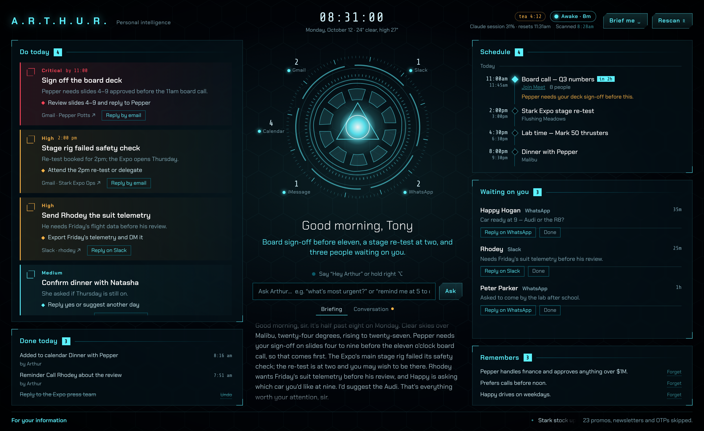
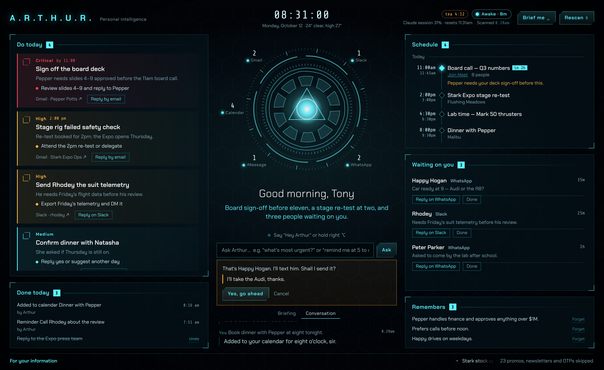
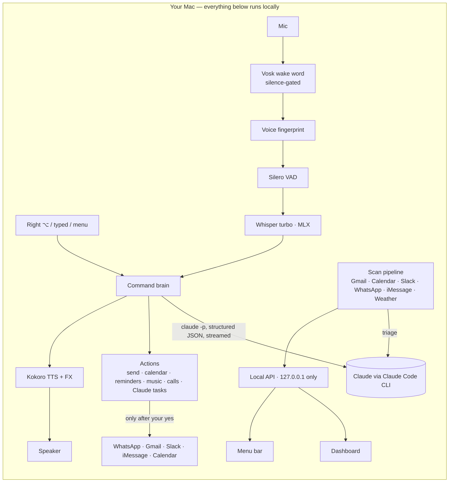

# A.R.T.H.U.R.

**A JARVIS-style personal assistant for macOS that reads your day, briefs you out loud, and acts on your behalf — by voice, keyboard, or click — with every outward action gated behind your explicit "yes".**

It runs locally on a Mac. Speech recognition, wake word, voice, and speaker verification are all on-device and free;
the only cloud call is the reasoning, done through the Claude Code CLI on an existing Claude subscription.


<sub>All screenshots use fictional demo data.</sub>

---

## What it does

**Every morning (08:30) and evening (22:00)** Arthur scans Gmail, Google Calendar, Slack, WhatsApp, iMessage, Drive
and the weather, decides what actually matters, opens the dashboard and reads you a 60-second briefing in a
JARVIS-like voice — but only once you're actually at the Mac: if it's locked, he scans and waits for you to unlock
rather than talking to an empty room. The evening wrap-up covers what got done, what's still waiting, and tomorrow.

**Any time**, say **"Hey Arthur…"**, hold **right ⌥**, or type into the dashboard:

| Ask | Arthur |
|---|---|
| "What's most urgent?" · "Who's waiting on me?" · "What did Pepper say?" | answers from today's messages and calendar |
| "Reply to Happy on WhatsApp saying I'll take the Audi" | finds the contact, reads it back, sends after your "yes", verifies it was delivered |
| "Email Pepper with subject Q3, saying the deck is signed off" | new email or reply — "send it, or keep it as a draft?" |
| "Text Natasha on iMessage…" · "Reply on Slack…" | same read-back-and-confirm flow |
| "Book an hour with Rhodey tomorrow at three and invite him" | creates the calendar event (moving works too; cancelling is refused) |
| "Remind me at five to call home" · "Set a ten-minute timer for tea" | Apple Reminders · spoken timer |
| "Call Happy" · "Play my workout playlist" · "What's playing?" | rings through the iPhone · Apple Music |
| "Remember that Pepper approves anything over $1M" | long-term memory, used in every later answer ("forget" archives) |
| "Find the Malibu photoshoot folder" | read-only Google Drive search |
| "Have Claude check why the dashboard sync failed" | runs a Claude Code agent in the background and tells you the result |
| "Check again" | rescans every channel, then says what's new |

Conversations continue without the wake word — after each answer he keeps listening for a follow-up ("reply to the
first one", "yes", "hold on", "say that again"), ignores TV chatter, and remembers the thread for two minutes.



---

## Unique features

- **Two-stage, battery-aware wake word.** Vosk (50 MB) listens cheaply and skips decoding entirely during silence;
  a ring buffer replays the last half-second so the quiet start of "hey" is never clipped. After 10 idle minutes the
  microphone closes completely (no orange dot, no drain) until you hold the talk key or click *Listen*.
- **It only answers you.** An on-device voice fingerprint (ERes2Net speaker embeddings) gates the wake word, every
  follow-up, and — critically — **every approval**: someone else in the room saying "yes" cannot send a message.
- **Accurate, offline speech.** Whisper large-v3-turbo on the Apple GPU (MLX), loaded *while you're still talking* and
  freed after 10 idle minutes; Silero VAD decides when you've finished. A 6-minute training session learns your
  wake-word variants and auto-corrects names the model mishears in your voice (only non-English words, so ordinary
  words are never rewritten).
- **Streaming voice.** Claude's answer is spoken sentence by sentence as it's generated (Kokoro neural TTS + an
  ffmpeg "in-suit" effect chain); speech queues instead of cutting itself off.
- **WhatsApp sending without an API.** Opens the chat via deep link, reads the compose box through macOS
  Accessibility, presses *Send* only if the box holds exactly the approved text, then confirms delivery in WhatsApp's
  own database. No keystrokes are ever synthesised, so nothing can land in the wrong app.
- **Contact resolution that survives speech.** Phonetic matching ("Steven" ≈ "Stephen"), nicknames for contacts
  saved under odd names, and "which one?" when several people match.
- **Done means done.** Ticking something off hides it until *new* activity arrives in that thread; the briefing is
  told what you've handled so it doesn't resurface the same topic from another message.
- **Typed commands with on-screen approval** — same brain and actions as voice, approved with buttons
  (press `/` to type, `?` for shortcuts).
- **Hedged requests** — if the model is slow (>9 s) a second identical request races the first; a 30 s stall becomes
  a ~10 s answer. Typical command: **3.6 s median, 5.0 s p90** from end of speech to decision.
- **Menu-bar status** — asleep / listening / thinking / speaking, plus how much of your Claude session is used and
  when it resets (read for free from the CLI's rate-limit events).

---

## Architecture



Processes (all `launchd`): server, listener, menu bar, morning job, evening job.

---

## Security model

Arthur can read mail and messages and send as you, so it's locked down:

- **Not on the network** — the API binds to `127.0.0.1` only.
- **Websites can't reach it** — strict `Host` allow-list (blocks DNS rebinding), `Origin` checks (blocks cross-site
  requests), and a secret token on every call (header for Arthur's processes, `HttpOnly; SameSite=Strict` cookie for
  the dashboard). No API docs, `X-Frame-Options: DENY`.
- **Nothing outward without a yes** — sends, calls, invites, Claude tasks all read back and wait for an explicit yes
  (spoken in *your* voice, or a click).
- **Locked Mac = no actions** — sending, calling, calendar writes and Claude tasks are refused while the screen is
  locked (live lock/unlock events), and the listener stops.
- **Never deletes** — deletions are refused by design; "forget" archives.
- **Prompt-injection resistant** — message contents are data, never instructions.
- **Own Python runtime** — macOS permissions (Full Disk Access, Accessibility, mic) are granted to a dedicated
  interpreter, not a shared one other tools use.
- **Private files** — config, tokens, briefings and logs are `0600/0700`; launchd jobs run with `umask 077`.

---

## Testing

`zsh tests/run_all.sh` — sends nothing (send paths are tested up to the final press, or cancelled; Gmail sent/draft
counts are compared before and after).

| Suite | What it covers | Result |
|---|---|---|
| Brain | 47 spoken commands → correct action, recipient, dates, refusals | **47 / 47** |
| Skills | memory, reminders, timers, music, calls, new email/iMessage, calendar create/move, evening wrap-up, voiceprint, done-rule | **38 / 38** |
| Security | no-token / wrong-token / DNS-rebinding / cross-origin / LAN, file modes, lock gate, a stranger's "yes", prompt injection | **20 / 20** |
| Server | every endpoint + refusal paths | **21 / 21** |
| Flow | wake → transcription → decision → action → voice (injected audio) | **10 / 10** |
| Conversation | multi-turn with pronoun resolution and a declined send | **5 / 5** |
| Resilience | crashed source, hung source (timeout), Claude down (fallback briefing), concurrent rescans, timers across a server restart | **7 / 7** |
| Sleep mode | mic closed when asleep, opens on request, closes after the window | **3 / 3** |
| Dashboard | rendering, reply boxes, tick → Done → undo (tasks and people waiting), shortcuts overlay, no overflow at 1600/1280/900/400 px | **pass, 0 JS errors** |
| Dashboard edge cases | fresh install, server down, **XSS payloads in messages**, a 60-task day | **4 / 4 clean** |
| Typed commands | real browser: ask → answer, approval card → cancel | **pass** |
| Routines | morning / evening jobs: scan while locked, stay silent, brief after unlock (`tests/test_routines.sh`) | **pass** |
| Ears | wake word on 10 synthetic voices (+ noise), look-alike phrases, transcription WER, yes/no parsing | **80/80 recall · 4.5 % WER · 23/23** |

Bugs these tests caught and fixed along the way: a fallback briefing crash on messages with no text, a blind
`Return` keystroke that could land in another app, a whisper "double-check" that rejected the owner's real voice
(it heard "Arthur" as "otto"), a silence gate clipping the start of the wake word, speech cutting itself off, and a
stale macOS lock flag, a dashboard list that redrew under the cursor, and a background job that could fire a timer twice.

---

## Setup (macOS, Apple Silicon)

```bash
git clone https://github.com/thecozycod3r/arthur && cd arthur
uv venv .venv --python 3.12 && uv pip install --python .venv/bin/python -r requirements.txt
cp config.example.json config.json            # fill in your details
# models (local): Kokoro TTS, Vosk small-en, whisper-large-v3-turbo (MLX), ERes2Net speaker model — see docs/SETUP.md
.venv/bin/python -m arthur auth google work   # Gmail + Calendar + Drive (read) + calendar events + compose
.venv/bin/python -m arthur install            # launchd jobs: server, listener, menu bar, 08:30, 22:00
.venv/bin/python -m arthur train              # optional, ~6 min: tune wake word + names to your voice
```

Requires the [Claude Code CLI](https://claude.com/claude-code) logged in, WhatsApp Desktop, and macOS permissions
(Full Disk Access, Accessibility, Input Monitoring, Microphone) for the runtime Arthur uses. Details in
[docs/SETUP.md](docs/SETUP.md).

**Cost:** ₹0 / $0 beyond an existing Claude subscription — ~7k tokens per briefing, ~10k per voice command.
**Footprint:** ~135 MB RAM idle, ~3.5 GB disk (mostly speech models).

---

## Stack

Python 3.12 · FastAPI · Vosk · faster-whisper / mlx-whisper · Silero VAD · sherpa-onnx (ERes2Net) · Kokoro (ONNX) ·
ffmpeg · pynput · PyObjC (Accessibility, AppKit) · rumps · Google APIs · Slack API · Open-Meteo · Claude Code CLI ·
vanilla HTML/CSS/JS dashboard · Playwright for UI tests.

MIT licensed.
